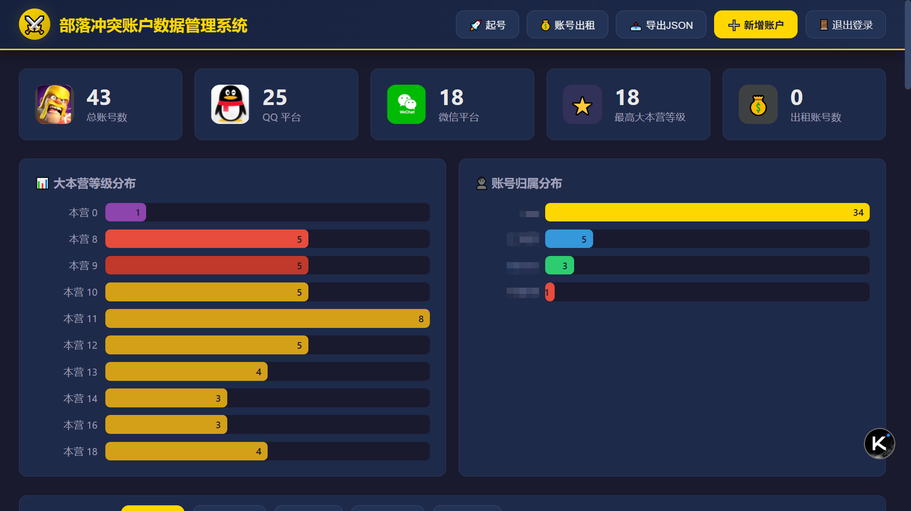

# 部落冲突账号管理系统

<div align="center">

一个用于管理《部落冲突（Clash of Clans）》游戏账号的轻量级Web / 桌面双形态工具。

基于 **Flask + 原生 HTML/CSS/JS**，数据存于 SQLite。既可作为桌面窗口程序离线使用，也可部署到服务器作为带口令验证的在线服务。

</div>

## 功能特性

- **账号主表**：按「本人 / 朋友 × QQ / 微信」四个维度对账号分类管理，支持增删改查、搜索筛选
- **仪表盘统计**：总账号数、平台分布、大本营等级分布、账号归属分布等可视化图表
- **起号管理**：把主表账号标记为"起号"，跟踪 `当前本 → 目标本` 进度；设备号唯一性校验、可编辑序号、最后登录时间生命周期管理
- **账号出租**：记录账号出租情况
- **JSON 导出**：一键导出全部账号、出租、月度数据（Web 版由浏览器直接下载）
- **双形态运行**：
  - 桌面版：pywebview 原生窗口，绑定本地端口
  - Web 版：waitress 生产服务器，`COC_WEB=1` 启动，自带自定义登录页与 session 口令验证
- **安全设计**：口令走环境变量、防时序攻击比对、登录页免弹窗、危险接口（清空数据）默认禁用

## 运行界面截图

> 仪表盘（统计概览）



*界面为深色紫金主题；截图中归属人姓名已做隐私打码处理。*

## 快速开始

### 环境要求

- Python 3.10+
- 依赖：`flask`、`waitress`、`openpyxl`（Web 版）；打包桌面版另需 `pyinstaller`、`pywebview`、`pythonnet`、`clr_loader`

### 方式一：Web 服务版（推荐）

```bash
pip install flask waitress openpyxl

export COC_WEB=1
export COC_WEB_PORT=8000
export COC_WEB_USER=admin
export COC_WEB_PASS='your-strong-password'   # 请务必设置强口令
# 可选：固定 session 密钥，避免重启后掉登录
export COC_WEB_SECRET='a-long-random-secret'

python launcher.py
```

浏览器打开 `http://<服务器IP>:8000`，输入账号口令即可登录。

> ⚠️ 口令**不会**写死在源码里，必须通过环境变量 `COC_WEB_PASS` 传入；未设置时程序拒绝以无口令方式启动。

### 方式二：桌面窗口版

```bash
pip install flask pywebview openpyxl
python launcher.py          # 不设 COC_WEB 即为桌面模式，自动打开原生窗口
```

如需打包成 `.exe` 可执行文件，使用 PyInstaller：

```bash
pip install pyinstaller pywebview pythonnet clr_loader
python rebuild.py           # 编译 .pyc + 打包，输出到 dist_rebuild_<时间戳>/
```

`rebuild.py` 支持：
- `python rebuild.py --compile-only`：只把 `appmods/*.py` 编译成 `.pyc`
- `python rebuild.py --verify-only`：校验源码与 `.pyc` 字节码一致性
- 构建解释器可用环境变量 `COC_BUILD_PY` 指定；`spec` 的 site-packages 路径可用 `COC_BUILD_SITE` 覆盖

### Docker 部署

```dockerfile
FROM python:3.13-slim
ENV PYTHONUNBUFFERED=1 TZ=Asia/Shanghai
RUN pip install --no-cache-dir flask waitress openpyxl
WORKDIR /app
COPY . /app
EXPOSE 8000
CMD ["python", "-u", "launcher.py"]
```

```bash
docker build -t coc-web .
docker run -d --name coc-web --restart always -p 8000:8000 \
  -e COC_WEB=1 -e COC_WEB_PORT=8000 \
  -e COC_WEB_USER=admin -e COC_WEB_PASS='your-strong-password' \
  -e COC_WEB_SECRET='a-long-random-secret' \
  -v /your/data/dir:/app/appmods \
  coc-web
```

将数据库文件 `coc_database.db` 放在挂载目录的 `appmods/` 下即可持久化数据（首次启动会自动创建空库）。

## 目录结构

```
.
├── launcher.py                  # 启动器：桌面/Web 双模式路由、口令验证、后端增强补丁
├── appmods/
│   ├── app.py                   # Flask 路由定义
│   ├── database.py              # 数据访问层（建表、增删改查、统计）
│   └── import_data.py           # 数据导入导出逻辑
├── templates/
│   └── index.html               # 前端单页（原生 JS，无框架）
├── docs/
│   └── screenshot.png           # 运行界面截图
├── tests/
│   ├── e2e_raising_test.py      # 起号逻辑端到端测试
│   └── e2e_v2_test.py           # 锁定/统计/导出等端到端测试
├── app.ico                      # 程序图标
├── COC_Account_Manager.spec     # PyInstaller 打包配置
├── rebuild.py                   # 一键编译/打包脚本
└── README.md
```

## 数据模型说明

账号数据统一存放在 `accounts` 表，几个关键约定：

- **起号 = `accounts` 表里 `device_number` 非空的一行**，并非独立表；账号始终留在主表中，起号只是打了一个标记
- **新增起号只能从主表选取**（`POST /api/raising/promote`），不会凭空新建账号
- **最后登录时间三态**：设为起号 → 清空；完成 / 取消起号 → 自动填入当天日期
- **主表锁定**：起号账号在主表中不可直接编辑/删除（后端返回 403），须走起号管理，或先结束起号解锁
- **统计口径**：起号账号仍计入总账号数与各维度分布

数据库首次运行由 `database.py` 的 `init_db()` 自动建表，并对老库做 `ALTER TABLE` 兼容升级。

## 安全提示

- 部署公网时**务必**使用强口令并考虑启用 HTTPS（可借助 Nginx / 宝塔反向代理申请免费证书）
- `COC_WEB_PASS`、`COC_WEB_SECRET` 等敏感值只通过环境变量传入，请勿提交到仓库
- 「清空数据」接口在本版本中已禁用，避免登录后的误操作或 CSRF 导致数据丢失
- 本仓库不包含任何真实账号数据；截图中的归属人姓名已打码

## 测试

`tests/` 下的端到端脚本会针对运行中的服务（默认 `127.0.0.1:5000`，可用 `COC_TEST_PORT` 覆盖）打 API，覆盖起号进度字段、设备号唯一性、目标等级校验、完成回填、主表锁定、统计口径、JSON 导出等断言。

```bash
# 先启动一个空库实例，再运行
python tests/e2e_raising_test.py
python tests/e2e_v2_test.py
```

## License

仅供个人学习与内部使用。
